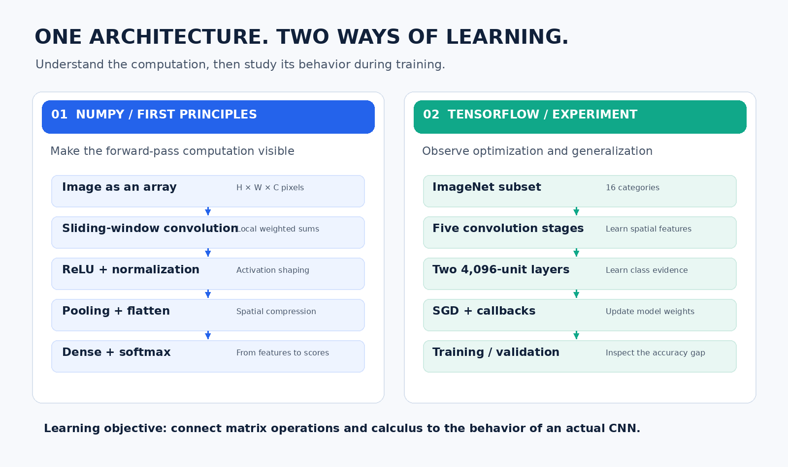
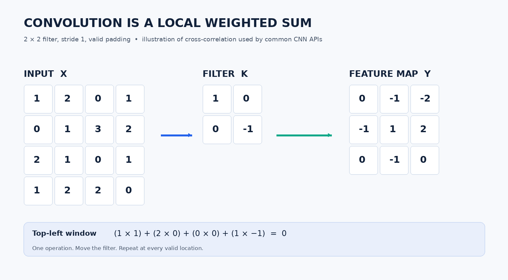
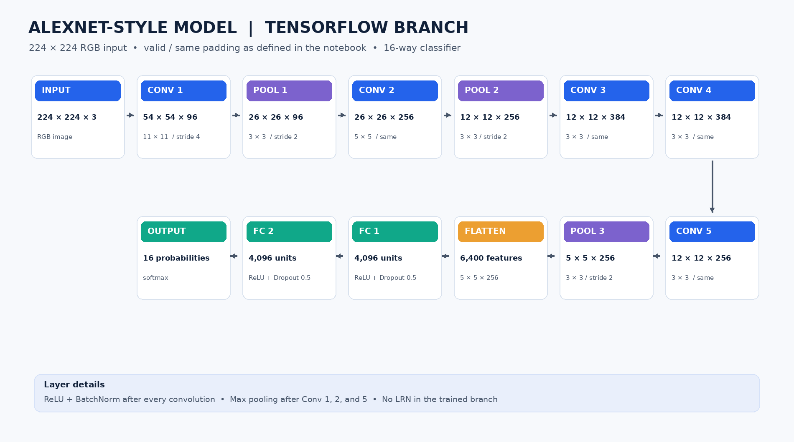
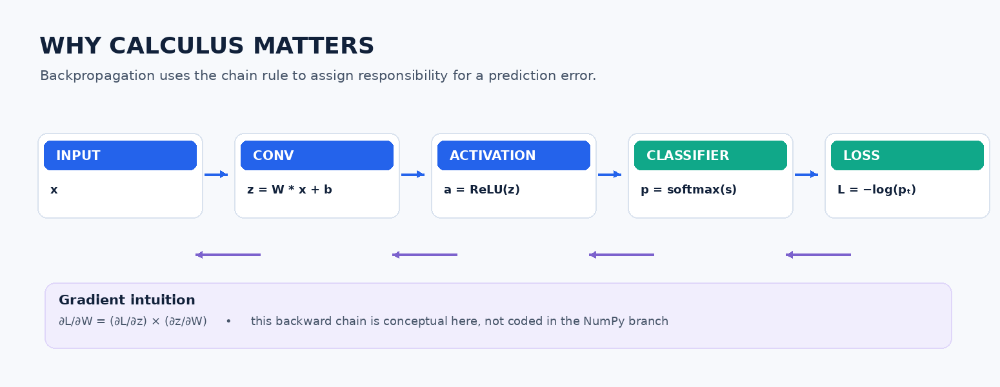
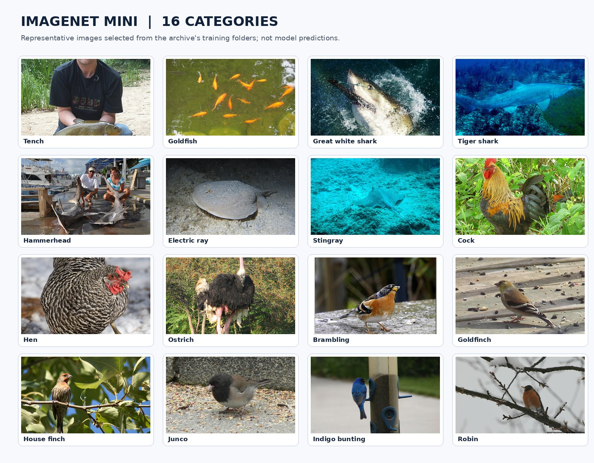
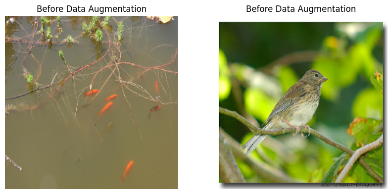
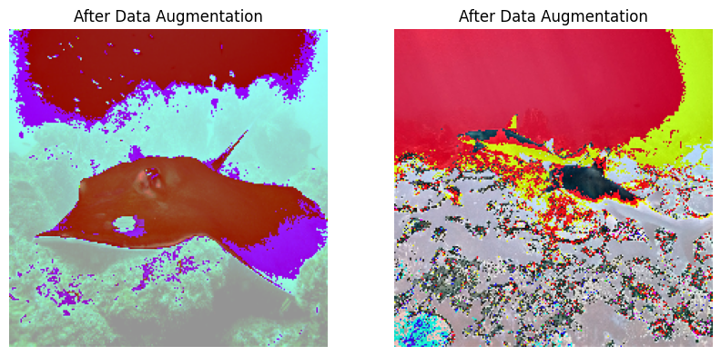
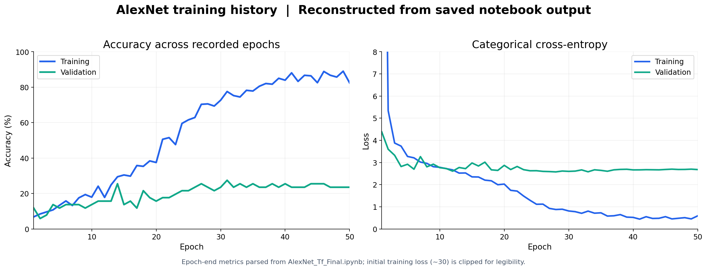

# AlexNet From Scratch — Technical & Mathematical Deep Dive

> **An implementation study of what a convolutional neural network does under the hood.**
>
> This document accompanies the [project README](README.md) and the code in [`AlexNet_Tf_Final.ipynb`](AlexNet_Tf_Final.ipynb). It connects the intuition, tensor arithmetic, calculus, architecture, preprocessing, training procedure, and observed evidence of a collaborative AlexNet investigation.

**Primary source:** the notebooks and dataset in this repository. **Scientific starting point:** Krizhevsky, Sutskever, and Hinton's 2012 AlexNet paper, linked in the [references](#references-and-source-material). Mathematical derivations below clarify underlying principles; they should **not** be mistaken for additional code that was implemented but is absent from the notebook.

---

## Contents

1. [The research problem](#1-the-research-problem)
2. [Why study the same network in two ways?](#2-why-study-the-same-network-in-two-ways)
3. [Approach I — understanding CNN operations manually](#3-approach-i--understanding-cnn-operations-manually)
4. [Putting the custom components together](#4-putting-the-custom-components-together)
5. [Approach II — building the trainable TensorFlow model](#5-approach-ii--building-the-trainable-tensorflow-model)
6. [What calculus explains about learning](#6-what-calculus-explains-about-learning)
7. [Data selection, splitting, and preprocessing](#7-data-selection-splitting-and-preprocessing)
8. [Optimization and experiment execution](#8-optimization-and-experiment-execution)
9. [Results and analysis](#9-results-and-analysis)
10. [Experimental limitations and interpretation](#10-experimental-limitations-and-interpretation)
11. [Reproducing or extending the study](#11-reproducing-or-extending-the-study)
12. [Lessons that transfer to other architectures](#12-lessons-that-transfer-to-other-architectures)
13. [References and source material](#references-and-source-material)

---

## 1. The research problem

An ordinary image is a grid of numbers. A classification network must transform those numbers into evidence for a semantic category. The interesting part is not the final label alone; it is **the sequence of operations that makes the label computable**.

AlexNet is a useful case study because its architecture exposes nearly every fundamental concept in an introductory yet substantial convolutional neural network:

- **Convolution:** local spatial computations with shared weights.
- **Activation:** nonlinear functions that let layers build richer representations.
- **Pooling:** reduction of spatial resolution by summarizing local neighborhoods.
- **Normalization:** rescaling activations according to neighboring channels or statistics.
- **Fully connected projection:** combining learned visual features into class scores.
- **Regularization and optimization:** shaping a model's behavior during training.

We investigated this network to understand **how the mathematics becomes a working implementation**. The final TensorFlow experiment is therefore the second half of the study, not its sole measure of success.



### Learning goals

The work was organized around several questions:

1. Can we write the essential forward operations ourselves and predict their tensor shapes?
2. How do convolution kernels, pooling windows, normalization, and dense layers compose into a deep network?
3. Why are nonlinearity and differentiation necessary for learning?
4. What does a trainable version of the same architectural ideas look like in TensorFlow?
5. How should we interpret training behavior when the dataset is much smaller than the model's capacity?

### Two kinds of correctness

A first-principles demonstration can be valuable **because the computation is inspectable**, even if it is not an optimized training library. A framework experiment can be valuable **because optimization behavior is measurable**, even when it does not achieve strong generalization. These are different evaluation targets and should remain distinct.

---

## 2. Why study the same network in two ways?

| Dimension | Approach I: custom operations | Approach II: TensorFlow / Keras |
| --- | --- | --- |
| Main objective | Expose layer arithmetic and data flow | Study parameter optimization and classification behavior |
| Primary building blocks | NumPy loops, slices, array multiplication, sums, matrix multiplication | Keras `Sequential`, layers, optimizer, callbacks |
| Input used in the sample | Random `227 × 227 × 3` array | Resized `224 × 224 × 3` dataset images |
| Output | One forward result shaped `(1, 1000)` | 16-class softmax predictions |
| Where weights come from | Newly initialized in custom layer objects | Trainable weights updated through Keras |
| Backward pass | Not implemented as a custom training system | Automatically computed by TensorFlow |
| Evaluation | Shape / forward-computation demonstration | Logged train/validation loss and accuracy |
| Meaning of “from scratch” | CNN fundamentals coded explicitly | Architecture assembled from high-level layers |

**Important nuance:** the assembled custom `AlexNetModel` calls **NumPy-based implementations of convolution, pooling, dense, and local response normalization**, but it calls `tf.nn.relu`, `tf.nn.dropout`, and `tf.nn.softmax` for other operations. Likewise, the separate batch-normalization notebook studies a hand-written normalization class, but the **trained Keras model** uses `tf.keras.layers.BatchNormalization`.

No PyTorch training implementation is present in the inspected archive. TensorFlow/Keras is the framework used for training.

---

## 3. Approach I — understanding CNN operations manually

### 3.1 An image as a tensor

For a color image, the input is a three-dimensional array:

\[
X\in \mathbb{R}^{H\times W\times C}
\]

Here, \(H\) and \(W\) are the image height and width, and \(C=3\) corresponds to RGB channels. A CNN does not directly recognize a "bird" in these arrays. Instead, it computes progressively transformed arrays called **feature maps**.

The first-principles notebooks show how those maps can be constructed from the same basic mathematical primitives used throughout linear algebra: multiplication, addition, maxima, and elementwise functions.

### 3.2 Convolution — learning to detect patterns locally

**Intuition.** Imagine looking through a small window that moves across the image. At every position, a filter multiplies the visible pixels by its own weights, adds them, and produces one number. Repeating the operation creates a map of where the filter responds strongly.

A single filter for an RGB image has weights over both its spatial neighborhood and all input channels. With \(F\) filters, the result has \(F\) output channels:

\[
W\in\mathbb{R}^{F\times K_h\times K_w\times C_{in}},\qquad
Y\in\mathbb{R}^{H_{out}\times W_{out}\times F}.
\]

For the cross-correlation operation computed by the notebook's `Conv2D.forward` (commonly called convolution in deep-learning APIs):

\[
Y[i,j,f]
=\sum_{u=0}^{K_h-1}\sum_{v=0}^{K_w-1}\sum_{c=0}^{C_{in}-1}
X[is+u,js+v,c]W[f,u,v,c].
\]

The notebook does not reverse the kernel, so mathematically the inner operation is **cross-correlation**. This is standard terminology in CNN implementations even though the layer is named convolution.



**Output size.** For padding \(P\), kernel width \(K\), and stride \(S\), the usual formula along one spatial dimension is:

\[
O=\left\lfloor\frac{I+2P-K}{S}\right\rfloor+1.
\]

For the notebook's first standalone example:

\[
I=227,\quad K=11,\quad S=4,\quad P=0
\quad\Rightarrow\quad
O=\left\lfloor\frac{227-11}{4}\right\rfloor+1=55.
\]

With 96 kernels, the observed output is therefore **`(55, 55, 96)`**, matching the notebook's printed result.

**How it is implemented.** In [`Inbuilt_Modules_Vs_Custom2/Conv2D.ipynb`](Inbuilt_Modules_Vs_Custom2/Conv2D.ipynb) and the main notebook, the custom layer:

1. Initializes a filter bank using `np.random.randn` when first given input data.
2. Applies zero padding when requested.
3. Calculates feature-map spatial dimensions.
4. Loops over output filters, spatial rows, and spatial columns.
5. Extracts a local image region using NumPy slicing.
6. Evaluates `np.sum(region * kernel)` and stores the result.

A shortened illustration reflecting the implementation is:

```python
for f in range(self.filters):
    kernel = self.kernels[f]
    for y in range(output_height):
        for x in range(output_width):
            region = image[
                y * self.stride:y * self.stride + kernel_height,
                x * self.stride:x * self.stride + kernel_width,
                :
            ]
            result[y, x, f] = np.sum(region * kernel)
```

**Why this matters:** seeing the slices, products, and sums makes it evident that a convolution is not a magical feature detector. It becomes useful once the filter weights acquire task-relevant values through optimization. The custom demonstration shows the mechanics using randomly initialized filters; it does **not** show learned edge detectors.

**Implementation detail:** the custom `padding='same'` branch uses symmetric padding based on `(kernel_size - 1) // 2`. This works for the odd-sized, stride-1 examples used there, but is not a complete implementation of all framework-style `SAME` padding cases.

### 3.3 ReLU — why linear algebra alone is not enough

After a convolution, the project applies the rectified linear unit:

\[
\operatorname{ReLU}(z)=\max(0,z).
\]

For a sample vector such as \([1,-1,-0.5,0.32]\), the output is \([1,0,0,0.32]\).

**Intuition.** A stack of linear functions without nonlinear activations can be collapsed into one linear function. Adding a nonlinear step lets each successive layer construct more expressive feature representations.

The derivative, almost everywhere, is:

\[
\operatorname{ReLU}'(z)=
\begin{cases}
1 & z>0,\\
0 & z<0.
\end{cases}
\]

At \(z=0\), one adopts a subgradient convention; frameworks handle this automatically. The derivative helps explain why some signals pass backward through activated units, while others are blocked.

**Source distinction:** in the main custom assembly, this activation is called through **TensorFlow's `tf.nn.relu`**, not through a manually written NumPy ReLU function. The notebook contains a separate simple ReLU demonstration.

### 3.4 Max pooling — compressing the spatial representation

Given a local window \(\Omega(i,j)\), max pooling returns the strongest response:

\[
Y[i,j,c]=\max_{(u,v)\in\Omega(i,j)} X[u,v,c].
\]

Unlike convolution, the max-pooling layer has **no learned filter weights**. It changes how activations are aggregated, usually shrinking the spatial dimensions.

The custom implementation in [`MaxPooling2D.ipynb`](Inbuilt_Modules_Vs_Custom2/MaxPooling2D.ipynb) and the main notebook loops across output positions and channels, slices a window, and runs `np.max(region)`.

For the included example:

- Input: `55 × 55 × 96`.
- Pool: `3 × 3`.
- Stride: `2 × 2`.
- Padding: valid.
- Output: **`27 × 27 × 96`**.

The conceptual backward derivative of a max operation routes gradient to the maximum element(s) selected during the forward pass. The notebook studies pooling **forward propagation**; it does not implement a max-pooling backward operator.

### 3.5 Dense layers — projecting features into decisions

Once the final feature maps are flattened, dense layers transform vectors through weighted sums:

\[
Z=XW+b.
\]

For a minibatch:

\[
X\in\mathbb{R}^{B\times d_{in}},\qquad
W\in\mathbb{R}^{d_{in}\times d_{out}},\qquad
Z\in\mathbb{R}^{B\times d_{out}}.
\]

The custom `Dense` class provides:

```python
self.weights = np.random.randn(in_features, out_features) * np.sqrt(2. / in_features)
self.biases = np.zeros((1, out_features))

# Forward computation
return np.dot(input_data, self.weights) + self.biases
```

Its weights use a **He-style scaling factor**, \(\sqrt{2/d_{in}}\), relevant to networks with ReLU activations. The output is an affine transformation; nonlinearity is applied separately in the assembled model.

For the 227-pixel custom assembly, the flattened representation is **9,216 features**, giving the first dense layer a 9,216-to-4,096 mapping. In the TensorFlow training architecture, the different input shape leads to a **6,400-feature** flattening step instead.

### 3.6 Local response normalization — competition between nearby channels

The project implements a custom `custom_LocalResponseNormalization` layer. For a location \((h,w)\) and channel \(c\), the intended operation is approximately:

\[
Y_{h,w,c}=\frac{X_{h,w,c}}{\left(k+\alpha\sum_{j\in N(c)}X_{h,w,j}^{2}\right)^{\beta}}.
\]

Here, \(N(c)\) is a channel neighborhood, \(k\) is a positive bias, and \(\alpha\) and \(\beta\) control the normalization strength.

**Intuition.** An activation is compared with surrounding channel activity: a value that is large relative to its neighbors may remain prominent, while magnitudes are rescaled by nearby energy.

The custom class uses default arguments `depth_radius=5`, `bias=1.0`, `alpha=1e-4`, `beta=0.75`. It squares the input, sums neighboring channel values, and rescales each activation. Its neighborhood is implemented using `c ± depth_radius // 2` (five channels in an interior position), not the full `±depth_radius` convention in every LRN API.

The separate [`Local Response Normalization.ipynb`](Inbuilt_Modules_Vs_Custom2/Local%20Response%20Normalization.ipynb) also demonstrates TensorFlow's `tf.nn.local_response_normalization` for comparison.

**Original versus trained model:** LRN appears in the first-principles demonstration, but **the final trained Keras network uses batch normalization rather than LRN**.

### 3.7 Batch normalization — understanding statistics as part of a network

The separate [`BatchNormalization.ipynb`](Inbuilt_Modules_Vs_Custom2/BatchNormalization.ipynb) implements a small NumPy class with train/evaluation behavior.

For feature-wise minibatch statistics:

\[
\mu_B=\frac{1}{m}\sum_{i=1}^{m}x_i,
\qquad
\sigma_B^2=\frac{1}{m}\sum_{i=1}^{m}(x_i-\mu_B)^2,
\]

\[
\hat{x}_i=\frac{x_i-\mu_B}{\sqrt{\sigma_B^2+\epsilon}},
\qquad
y_i=\gamma\hat{x}_i+\beta.
\]

The custom class initializes \(\gamma=1\), \(\beta=0\), and maintains exponentially updated running mean and variance for inference:

\[
\mu_{run}\leftarrow q\mu_{run}+(1-q)\mu_B
\]

with `momentum=0.9` by default. It exposes `update_params(gamma, beta)` but does not implement gradient calculation or optimizer-driven updates for those parameters.

The independent notebook example illustrates the concept; the training architecture directly uses Keras `BatchNormalization` layers.

---

## 4. Putting the custom components together

The class `AlexNetModel` in the main notebook and the larger custom-layer notebook combines operations into an AlexNet-inspired **single forward pass**:

```text
Random RGB sample: 227 × 227 × 3
  ↓  custom Conv2D(96, 11×11, stride 4, valid)
  ↓  TensorFlow ReLU → custom LRN
55 × 55 × 96
  ↓  custom MaxPooling2D(3×3, stride 2)
27 × 27 × 96
  ↓  custom Conv2D(256, 5×5, same) → ReLU → LRN
27 × 27 × 256
  ↓  custom MaxPooling2D(3×3, stride 2)
13 × 13 × 256
  ↓  custom Conv2D(384, 3×3, same) → ReLU
  ↓  custom Conv2D(384, 3×3, same) → ReLU
  ↓  custom Conv2D(256, 3×3, same) → ReLU
13 × 13 × 256
  ↓  custom MaxPooling2D(3×3, stride 2)
6 × 6 × 256
  ↓  Flatten: 9,216 features
  ↓  custom Dense(9,216 → 4,096) → ReLU → TensorFlow dropout
  ↓  custom Dense(4,096 → 4,096) → ReLU → TensorFlow dropout
  ↓  custom Dense(4,096 → 1,000) → TensorFlow softmax
Output shape: (1, 1000)
```

The saved notebook demonstrates `y.shape` as **`TensorShape([1, 1000])`**. This confirms the sample's output shape, not classification accuracy.

### Why this demonstration is not a training engine

- Custom layer constructors initialize weights, but the class does not define a manual backward pass.
- There is no loss-to-gradient computation for custom parameters, no optimizer step, and no trainable parameter-management loop.
- The model creates fresh custom layer objects inside `forward`, so weights would be reinitialized on repeated independent calls.
- The input used is random rather than a labeled example in the 16-class dataset.
- The 1,000-way output illustrates the original AlexNet classification scale, while the separate trained model has 16 outputs.

This is still a meaningful artifact: it traces data through the architecture at the level of individual array computations. The trade-off is that nested Python/NumPy loops are far slower than optimized TensorFlow kernels, particularly with hundreds of channels.

---

## 5. Approach II — building the trainable TensorFlow model

The second implementation uses a `tf.keras.models.Sequential` network defined in **cell 43 of the main notebook**. Here the purpose is not manual arithmetic; it is to train, evaluate, and interpret an actual CNN on labeled images.



### 5.1 Layer-by-layer tensor dimensions

The table below reflects **the actual model definition and saved Keras summary**, with `224 × 224 × 3` input and valid padding where `padding="same"` is not specified.

| Stage | Operation | Output shape (excluding batch dimension) |
| --- | --- | --- |
| Input | RGB | `224 × 224 × 3` |
| Conv 1 | 96 filters, `11×11`, stride 4, ReLU | `54 × 54 × 96` |
| Norm 1 | Batch normalization | `54 × 54 × 96` |
| Pool 1 | `3×3`, stride 2 | `26 × 26 × 96` |
| Conv 2 | 256 filters, `5×5`, same, ReLU | `26 × 26 × 256` |
| Norm 2 | Batch normalization | `26 × 26 × 256` |
| Pool 2 | `3×3`, stride 2 | `12 × 12 × 256` |
| Conv 3 | 384 filters, `3×3`, same, ReLU | `12 × 12 × 384` |
| Norm 3 | Batch normalization | `12 × 12 × 384` |
| Conv 4 | 384 filters, `3×3`, same, ReLU | `12 × 12 × 384` |
| Norm 4 | Batch normalization | `12 × 12 × 384` |
| Conv 5 | 256 filters, `3×3`, same, ReLU | `12 × 12 × 256` |
| Norm 5 | Batch normalization | `12 × 12 × 256` |
| Pool 3 | `3×3`, stride 2 | `5 × 5 × 256` |
| Flatten | Vectorization | `6,400` |
| FC 1 | Dense 4,096, ReLU + dropout `0.5` | `4,096` |
| FC 2 | Dense 4,096, ReLU + dropout `0.5` | `4,096` |
| Output | Dense 16, softmax | `16` |

### 5.2 Where the 46.8 million parameters come from

A standard dense or convolution operation learns coefficients. The number of parameters follows simple formulas:

**Convolution:**

\[
N_{conv}=(K_h\cdot K_w\cdot C_{in}+1)\cdot C_{out}
\]

The `+1` accounts for one bias per output filter. For the first convolution:

\[
(11\cdot11\cdot3+1)\cdot96
=\boxed{34,944}.
\]

**Dense:**

\[
N_{dense}=(d_{in}+1)\cdot d_{out}.
\]

For the first dense layer in the **trained** branch:

\[
(6400+1)\cdot4096
=\boxed{26,218,496}.
\]

That single transformation accounts for **more than half** of the model's 46.8 million parameters. This explains why large fully connected layers can contribute heavily to model capacity and overfitting risk.

Selected recorded parameter counts:

| Layer | Parameters |
| --- | ---: |
| Conv 1 | 34,944 |
| Conv 2 | 614,656 |
| Conv 3 | 885,120 |
| Conv 4 | 1,327,488 |
| Conv 5 | 884,992 |
| Dense 1 | 26,218,496 |
| Dense 2 | 16,781,312 |
| Output Dense | 65,552 |
| Five batch-normalization layers, combined | 5,504 |
| **Total** | **46,818,064** |

The saved Keras summary reports **46,815,312 trainable** and **2,752 non-trainable** parameters. Batch-normalization moving statistics contribute to non-trainable state in that accounting; its scale and shift remain trainable.

### 5.3 Relationship to the original AlexNet paper

The original AlexNet introduced an influential combination of convolutional processing, ReLU, pooling, normalization, fully connected classification, and large-scale supervised training. We used that design as the subject of an architectural investigation, rather than trying to reproduce its benchmark conditions.

| Aspect | Paper / historical AlexNet | This project's trained model |
| --- | --- | --- |
| Scale | Large-scale ImageNet classification | Small 16-category subset |
| Output | 1,000 classes | 16 classes |
| Normalization | Local response normalization in original architecture | Batch normalization after convolutions |
| Input geometry | Classic AlexNet discussion commonly uses 227-pixel input | 224 × 224 pixels |
| Architecture | Five convolutional layers, three fully connected layers | Five convolutional layers, three dense layers |
| Training objective | Large-scale image recognition benchmark | Educational image-classification experiment |

The paper's published benchmark scores must **not** be used as though they were reproduced here. The reported results in this repository are only the metrics of the 16-class experiment.

---

## 6. What calculus explains about learning

The most important theoretical bridge between a manually calculated forward pass and a trainable network is **backpropagation through the computation graph**.



This section explains concepts needed to understand a trained CNN. **The custom NumPy branch does not implement the following full backward computations.** TensorFlow performs automatic differentiation for the second approach.

### 6.1 The full forward chain

A simplified classifier can be written as:

\[
z^{(1)}=W^{(1)}*x+b^{(1)},
\]

\[
a^{(1)}=\mathrm{ReLU}(z^{(1)}),
\]

\[
\ldots\quad s=W^{(L)}a^{(L-1)}+b^{(L)},
\]

\[
p_k=\frac{e^{s_k}}{\sum_j e^{s_j}}.
\]

The final quantity \(p_k\) is the softmax probability assigned to class \(k\), based on the network's learned scores \(s\).

### 6.2 Cross-entropy — turning incorrect predictions into a scalar objective

Given one-hot ground-truth label \(y\) and predicted probabilities \(p\), categorical cross-entropy is:

\[
\mathcal{L}(y,p)=-\sum_{k=1}^{K}y_k\log p_k.
\]

For the correct class \(t\), this becomes \(\mathcal{L}=-\log p_t\). A high confidence in the correct class yields a small loss; a low confidence yields a larger loss.

This is the loss configured in the project's `model.compile(..., loss="categorical_crossentropy")` call.

### 6.3 The softmax plus cross-entropy simplification

For a single example, differentiation with respect to pre-softmax logits \(s\) leads to the elegant result:

\[
\frac{\partial\mathcal{L}}{\partial s_k}=p_k-y_k.
\]

This tells us the direction in which class scores should move. The predicted probability and true one-hot label together produce a teaching signal for earlier layers.

### 6.4 The chain rule — how earlier filters receive credit or blame

Every parameter contributes to the output through a chain of intermediate operations. The chain rule makes that relationship differentiable:

\[
\frac{\partial\mathcal{L}}{\partial W}
=\frac{\partial\mathcal{L}}{\partial z}
\frac{\partial z}{\partial W}
\]

where the general multi-dimensional case uses the appropriate Jacobian products and sums over contributing paths.

For a simple dense layer \(z=xW+b\), with incoming gradient \(\delta=\partial\mathcal{L}/\partial z\):

\[
\frac{\partial\mathcal{L}}{\partial W}=x^T\delta,
\qquad
\frac{\partial\mathcal{L}}{\partial b}=\sum_{batch}\delta,
\qquad
\frac{\partial\mathcal{L}}{\partial x}=\delta W^T.
\]

For a convolution, the same basic principle aggregates gradient contributions at every spatial position where a **shared kernel weight** was used. This is the mathematical reason a single filter can be improved from evidence across an entire image.

### 6.5 SGD — turning gradients into updated weights

At each optimization step, stochastic gradient descent applies a rule of the form:

\[
W_{t+1}=W_t-\eta\nabla_W\mathcal{L}(W_t),
\]

with learning rate \(\eta\). The implementation also passes `weight_decay=0.0005` to its SGD optimizer, so the actual update involves the optimizer's weight-decay behavior as implemented by the installed TensorFlow/Keras version.

This also explains the conceptual difference between the two approaches:

- The custom demonstration computes output values from initialized weights.
- The TensorFlow branch repeatedly computes outputs, measures loss, differentiates, and updates weights.

**Forward operations explain how the network thinks computationally; derivatives explain how it changes.**

---

## 7. Data selection, splitting, and preprocessing

### 7.1 What is in the dataset archive?

The source archive includes `Imagenet_mini/train/` and `Imagenet_mini/test/` directories organized by ImageNet synset identifiers. They represent a targeted selection of seven fish-related categories and nine bird-related categories.



Exact image counts from the provided ZIP:

| Synset | Category | `train/` | `test/` |
| --- | --- | ---: | ---: |
| `n01440764` | Tench | 34 | 3 |
| `n01443537` | Goldfish | 36 | 3 |
| `n01484850` | Great white shark | 37 | 5 |
| `n01491361` | Tiger shark | 47 | 3 |
| `n01494475` | Hammerhead | 37 | 5 |
| `n01496331` | Electric ray | 26 | 3 |
| `n01498041` | Stingray | 27 | 3 |
| `n01514668` | Cock | 25 | 3 |
| `n01514859` | Hen | 25 | 3 |
| `n01518878` | Ostrich | 22 | 3 |
| `n01530575` | Brambling | 42 | 4 |
| `n01531178` | Goldfinch | 33 | 4 |
| `n01532829` | House finch | 34 | 3 |
| `n01534433` | Junco | 32 | 4 |
| `n01537544` | Indigo bunting | 28 | 4 |
| `n01558993` | Robin | 28 | 3 |
| **Total** | **16 categories** | **513** | **56** |

Class labels are inferred from directory names by `tf.keras.preprocessing.image_dataset_from_directory`. The main notebook also contains a commented list of the human-readable class names.

### 7.2 Actual split logic

The notebook constructs both `df_train` and `df_valid` from **the same source directory**:

```python
tf.keras.preprocessing.image_dataset_from_directory(
    "Imagenet_mini/train",
    labels="inferred",
    label_mode="categorical",
    color_mode="rgb",
    batch_size=2,
    image_size=(224, 224),
    shuffle=True,
    seed=123,
    validation_split=0.1,
    subset="training",  # "validation" for the second dataset
)
```

The saved console output reports **462 training images and 51 validation images**. The additional 56 images in `Imagenet_mini/test/` are present but are **not used in the recorded final evaluation**.

### 7.3 Mean normalization: planned formula versus active implementation

For a dataset of pixel values, the notebook computes global scalar mean and standard deviation using accumulated sums and squared sums:

\[
\mu=\frac{1}{N}\sum_{i=1}^{N}x_i,
\]

\[
\sigma=\sqrt{\frac{1}{N}\sum_{i=1}^{N}x_i^2-\mu^2}.
\]

In an earlier exploratory cell, `normalize_image` returns `(image - mean) / std_dev`. Later, however, the **active function is redefined** as:

```python
def normalize_image(image, mean, std_dev):
    return image - mean
```

Therefore, the final experiment uses **mean subtraction**, not standard-deviation division. That distinction matters for faithful reproduction and for interpreting model input scales.

### 7.4 Horizontal reflection and brightness experiments

The notebook defines two image transformations:

```python
def horizontal_reflection(image, label):
    return tf.image.flip_left_right(image), label

def adjusting_brightness(image, label):
    return tf.image.adjust_brightness(image, 0.2), label
```

The final active `DataAugmentation(dataset)` function uses:

1. Mapping through the mean-subtraction transform.
2. Mapping through `horizontal_reflection`.
3. No brightness adjustment — the brightness line is commented out.

Both `normalized_train_df` and `normalized_valid_df` pass through the same function. The flip used is **deterministic** (`flip_left_right`), not a random flip. As a result, validation is also flipped, which limits how directly the validation experiment represents untouched future data.

### 7.5 Actual notebook visual evidence

The original notebook includes image previews before and after its active transformation pipeline.

| Resized input examples | Notebook's post-preprocessing preview |
| --- | --- |
|  |  |

**Display caution:** the second plot converts mean-subtracted floating-point tensors directly to `uint8` for plotting. Some visible colors may therefore reflect the visualization conversion, not an intended image-normalization output. The images are preserved as notebook evidence, not retouched results.

---

## 8. Optimization and experiment execution

### 8.1 The compiled model

In the final notebook, `compile_and_train_alexnet` instantiates the SGD optimizer and configures:

```python
sgd_optimizer = tf.keras.optimizers.SGD(
    learning_rate=0.01,
    weight_decay=0.0005,
    nesterov=False
)
model.compile(
    optimizer=sgd_optimizer,
    loss="categorical_crossentropy",
    metrics=["accuracy"]
)
```

The model begins with 46.8 million parameters but is trained on only 462 images in a training split. This intentionally creates an interesting setting for observing the relationship between representational capacity and available supervision.

### 8.2 Callbacks and state

The callback configuration is:

- **ModelCheckpoint:** saves weights each epoch under `model_training_excAdjBrig_incWeiDec/cp-{epoch:04d}.weights.h5`.
- **EarlyStopping:** watches **training loss** with `patience=10`.
- **ReduceLROnPlateau:** watches **validation loss**, multiplies learning rate by `0.1` after patience `10`, and enforces minimum rate `1e-6`.
- **Training limit:** `epochs=50`.

The saved notebook log shows all **50 epochs** executed. Learning-rate reductions appear in that history; their behavior is captured in [`training_history_from_notebook.csv`](training_history_from_notebook.csv).

Although checkpoints are configured in code, **the ZIP inspected for this documentation does not contain the checkpoint directory or weight files**. Reproducing the exact archived model state would therefore require access to the original weights or a fresh training run.

### 8.3 What the training loop delegates to TensorFlow

The notebook calls `model.fit(...)`. Under the hood, TensorFlow is responsible for framework-level operations including batched forward propagation, gradient computation, parameter updates, and metric accumulation. These are not manually implemented in the custom layer classes.

**Interpretation:** the project intentionally exposes the operations that *define* the network in one approach and then relies on framework machinery to explore *learning behavior* in the second.

---

## 9. Results and analysis

### 9.1 What was actually measured

The final two evaluation cells call `model.evaluate` on the preprocessed training and validation datasets.

| Dataset evaluated | Accuracy | Categorical cross-entropy |
| --- | ---: | ---: |
| Training subset (462 images) | **81.82%** | **0.7818** |
| Validation subset (51 images) | **23.53%** | **2.6801** |

These values were read from the notebook's existing outputs. The training run and evaluation were **not rerun** to produce this document.

### 9.2 Learning history reconstructed from source evidence

The saved cell output contains complete epoch-end metrics for 50 epochs. We extracted those values to create the following research figure:



Observations from the saved history:

- **Epoch 1:** training accuracy around `6.80%`, validation accuracy around `11.76%`; initial training loss is unusually high (`30.1090` at epoch end).
- **Epoch 31:** the highest recorded *epoch-end validation accuracy*, `27.45%`.
- **Epoch 28:** the lowest recorded *epoch-end validation loss*, `2.5752`.
- **Epoch 50:** epoch-end training accuracy `82.44%`, epoch-end validation accuracy `23.53%`.
- **Final post-training evaluation:** training accuracy `81.82%`, validation accuracy `23.53%`.

Epoch-end training metrics and subsequent evaluation can differ because of model behavior during training versus evaluation, along with metric aggregation and data processing. The notebook's two evaluation cells are the cleanest source for the **reported final** results.

The graph intentionally limits the loss-axis scale to keep later epochs visible; the initial training loss near 30 is **above the displayed axis**. The underlying recorded values remain in the accompanying CSV.

### 9.3 Interpreting the generalization gap

The final absolute difference is:

\[
81.82\%-23.53\%=\boxed{58.29\text{ percentage points}}.
\]

That is a large discrepancy between fitted and held-out performance, consistent with a model that has learned properties of its training subset much better than properties that generalize to validation images.

**Plausible contributors worth investigating, not proven causal explanations:**

- Extremely limited data relative to 46.8 million parameters.
- Class imbalance across the 16 folders.
- Differences between the small train/validation subsets.
- Preprocessing decisions, particularly deterministic flips applied to validation.
- Hyperparameters and regularization choices in a small-data regime.
- A training setup designed to study the architecture rather than optimize benchmark performance.

Even a simple 16-class uniform random guess would have a reference accuracy of \(1/16=6.25\%\), but using that baseline alone would not justify calling the trained model robust. **No independent test accuracy is available** from the existing notebook.

### 9.4 What the experiment establishes

The notebook demonstrates that the chosen model can be assembled and trained, that its training objective decreases relative to the initial epochs, and that its final validation accuracy is much lower than training accuracy.

It does **not** establish that the custom NumPy branch learned filters, that the 16-class results are comparable with the original 1,000-class ImageNet benchmark, or that the resulting model is suitable for deployment.

---

## 10. Experimental limitations and interpretation

A research study benefits from accounting for its boundaries. These limitations follow directly from the included code and artifacts:

| Limitation | Evidence in project | Why it matters |
| --- | --- | --- |
| No manual backward pass | Custom classes implement `.forward()` without parameter-gradient propagation | The first approach studies inference mechanics, not first-principles end-to-end training |
| Framework operations remain in the custom assembly | `tf.nn.relu`, `tf.nn.dropout`, `tf.nn.softmax` | The demonstration is intentionally hybrid rather than 100% NumPy |
| New weights in each assembled forward call | Custom layer instances are constructed within `AlexNetModel.forward` | The example is not a persistent trained model |
| Different input sizes | 227-pixel custom example versus 224-pixel training input | The flattened representation differs: 9,216 versus 6,400 |
| Different normalization choices | Custom LRN versus Keras batch normalization | Forward and training architectures are variants, not exact matches |
| Mean subtraction instead of z-scoring | Later `normalize_image()` overrides earlier definition | The effective preprocessing differs from the explored formula |
| Deterministic reflection on validation | Both splits use `DataAugmentation()` | The validation pipeline transforms images unnecessarily |
| Brightness function disabled | Brightness map commented out in final pipeline | It should not be presented as an augmentation used in the recorded run |
| Small training dataset | 462 training / 51 validation, 46.8M parameters | High capacity and limited supervision complicate generalization |
| Additional test folder not evaluated | Evaluation uses only `normalized_train_df` and `normalized_valid_df` | No independent test-set claim is supported |
| Missing saved weights in ZIP | Checkpoint callback exists, checkpoint files absent | Exact trained state cannot be recovered from inspected archive |
| Reproducibility not pinned | No dependency lock or dedicated execution script | Results and compatibility can differ across environments |

These points are not reasons to discard the project. They mark the boundary between **what was investigated**, **what was implemented**, and **what would be necessary for a more controlled benchmark**.

---

## 11. Reproducing or extending the study

### 11.1 Explore the notebooks

The original repository is organized around notebooks. Open these first:

- [`Inbuilt_Modules_Vs_Custom2/Conv2D.ipynb`](Inbuilt_Modules_Vs_Custom2/Conv2D.ipynb): broad first-principles layer discussion and custom assembly.
- [`Inbuilt_Modules_Vs_Custom2/MaxPooling2D.ipynb`](Inbuilt_Modules_Vs_Custom2/MaxPooling2D.ipynb): pool-window implementation.
- [`Inbuilt_Modules_Vs_Custom2/Local Response Normalization.ipynb`](Inbuilt_Modules_Vs_Custom2/Local%20Response%20Normalization.ipynb): custom/framework comparison.
- [`Inbuilt_Modules_Vs_Custom2/BatchNormalization.ipynb`](Inbuilt_Modules_Vs_Custom2/BatchNormalization.ipynb): running-statistics exploration.
- [`AlexNet_Tf_Final.ipynb`](AlexNet_Tf_Final.ipynb): the complete research sequence and the final training experiment.

From the repository root, a starting environment setup is:

```bash
python3 -m venv .venv
source .venv/bin/activate
python -m pip install --upgrade pip
python -m pip install numpy pandas matplotlib tensorflow jupyter
python -m jupyter notebook AlexNet_Tf_Final.ipynb
```

The project does **not** pin library versions. TensorFlow installation support is platform-specific, and full model training requires substantial memory and computation. Treat this as an exploration starting point rather than a guaranteed one-command reproduction.

### 11.2 How to follow the main notebook

The notebook's major stages are:

1. Import dependencies and introduce preprocessing.
2. Implement or demonstrate individual network operations.
3. Assemble a sample custom forward pass.
4. Define compilation and callback helpers.
5. Load images and create train/validation splits.
6. Normalize and transform image data.
7. Define the Keras AlexNet-style network.
8. Compile and train it.
9. Evaluate training and validation sets.

**Note:** several helper functions are redefined later in the notebook, including `normalize_image` and `DataAugmentation`. For faithful understanding, inspect the **final active definitions** before the training cells, not only the initial exploratory cells.

### 11.3 Useful follow-up experiments (proposals, not claims)

The following would make a subsequent scientific comparison more rigorous, but **they were not carried out in the recorded project**:

1. Compare custom NumPy layer outputs numerically against TensorFlow reference outputs using matched inputs and fixed kernels.
2. Implement a single-layer backward pass and verify it with finite-difference gradient checking.
3. Apply augmentation only to training images; retain deterministic, comparable validation preprocessing.
4. Use the existing `test/` directory for a final untouched evaluation.
5. Compare different model capacities, regularization schemes, and input resolutions.
6. Record per-class precision/recall, confusion matrices, and multiple random-seed runs.
7. Save environment specifications and a final checkpoint to support reproducibility.

These directions follow naturally from the project's original learning objective: proceed from **understanding forward mathematics**, to **understanding gradients**, to **testing the assumptions experimentally**.

---

## 12. Lessons that transfer to other architectures

AlexNet is a particular historical architecture, but the reasoning exercised here carries into many neural-network designs.

**1. Tensor shape reasoning is universal.** Whether dealing with CNNs, transformers, or sequence models, every operation constrains the shape of the next. Working out shapes manually makes debugging far less mysterious.

**2. Parameters are just numbers inside functions.** Convolution weights and dense-layer weights are mathematically ordinary arrays whose learned values create useful behavior. The learning algorithm determines those values.

**3. A deep model is a composition of simpler differentiable parts.** Convolutions, activations, normalization, and matrix multiplication are assembled into a computation graph. The chain rule explains how training reaches earlier parts of that graph.

**4. Architecture and learning procedure are separate questions.** We can implement a correct forward computation without training it; conversely, a framework can train an architecture without showing every intermediate detail. Both viewpoints are essential to engineering understanding.

**5. Evaluation belongs to the theory, not just the report.** The gap between training and validation behavior is a reminder that optimization and generalization are different phenomena. A model can fit a dataset and still fail to transfer that behavior beyond it.

The project's strongest result is therefore **conceptual visibility**: writing and inspecting the primitive operations behind a deep CNN, then watching a trainable implementation exhibit the successes and limitations of those same ideas.

---

## References and source material

### Primary research reference

Krizhevsky, A., Sutskever, I., & Hinton, G. E. (2012). **ImageNet Classification with Deep Convolutional Neural Networks.** *Advances in Neural Information Processing Systems, 25.* [Official NeurIPS article](https://papers.nips.cc/paper_files/paper/2012/hash/c399862d3b9d6b76c8436e924a68c45b-Abstract.html) · [Official paper PDF](https://papers.neurips.cc/paper/4824-imagenet-classification-with-deep-convolutional-neural-networks.pdf).

### Project evidence

- [`AlexNet_Tf_Final.ipynb`](AlexNet_Tf_Final.ipynb) — the main implementation, recorded outputs, and experiment history.
- [`Inbuilt_Modules_Vs_Custom2/`](Inbuilt_Modules_Vs_Custom2/) — separate mathematical/implementation explorations.
- [`AlexNet_Tf_Final_Doc.html`](AlexNet_Tf_Final_Doc.html) — exported notebook documentation.
- [`AlexNetUnderstandingNotes.pdf`](AlexNetUnderstandingNotes.pdf) — companion notes in the archived repository.
- [`Imagenet_mini/`](Imagenet_mini/) — the included 16-class data organization.
- [`training_history_from_notebook.csv`](training_history_from_notebook.csv) — values recovered from the archived 50-epoch console output.
- [`Group_contribution.txt`](Group_contribution.txt) — original team contribution record.

### Collaboration and project credit

The archived contribution record lists **Aswith Sama, Santhosh Kavi, and Divya Chintala** as group contributors. It attributes shared background research, architecture development, model training, and a CPU-oriented minimal working example, with responsibilities divided among team members. It records **Aswith's participation** in foundational research, architectural work, training, and the minimal working example. This documentation describes a collaborative investigation and does not assert exclusive ownership of the entire project.

---

**Back to the [README](README.md) · Explore the [original notebook](AlexNet_Tf_Final.ipynb)**
